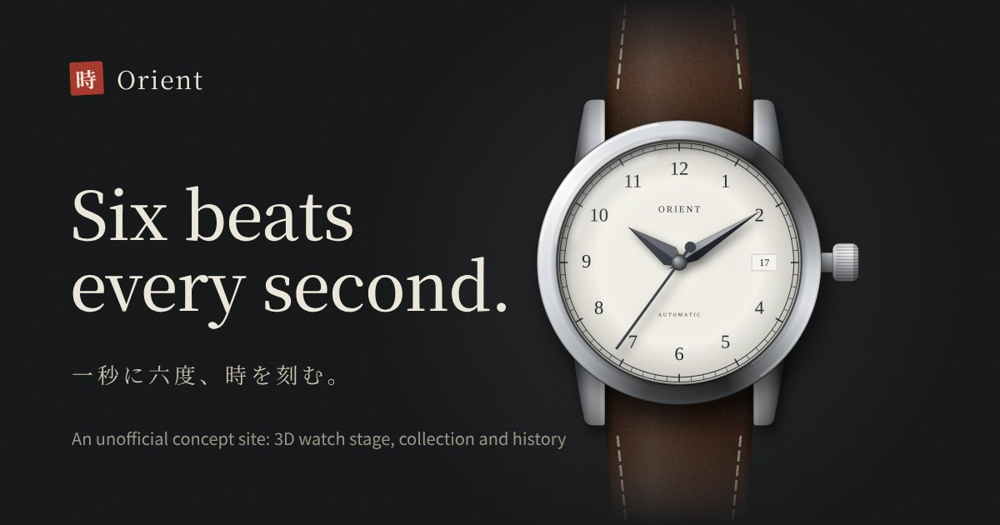
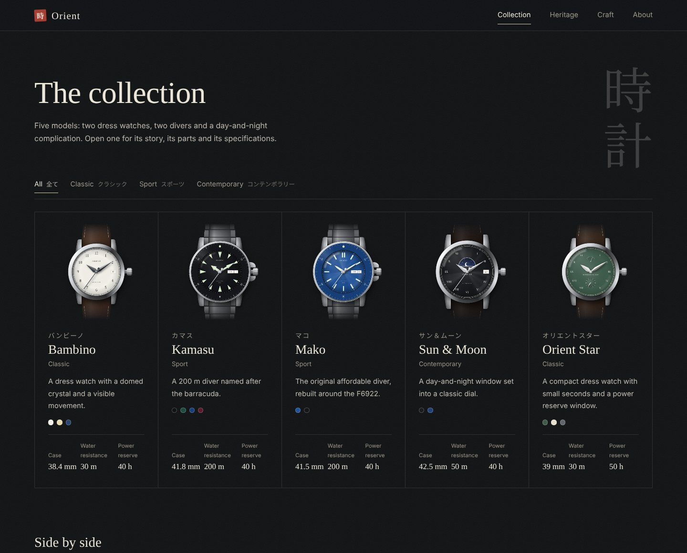
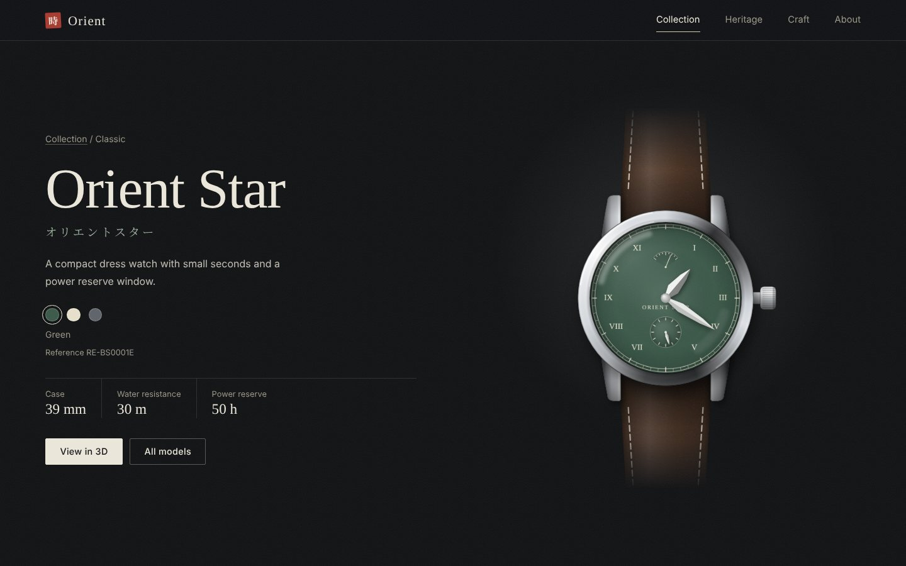
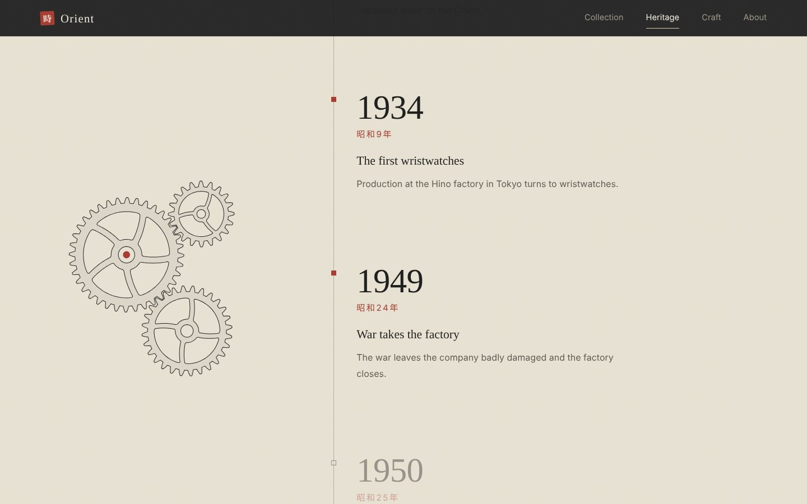
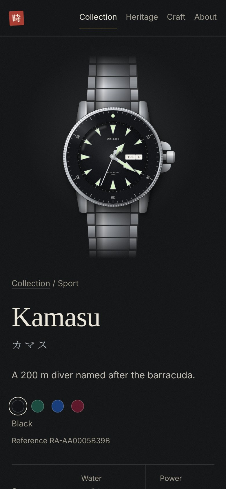

# Orient: a concept site for a Japanese watchmaker



An unofficial concept for a web development portfolio, built around Orient's mechanical watches: a watch movement turning in the hero, a 3D watch you can rotate and take apart, a collection, a page per model, a history from 1901 and a page on how the mechanism works.

**Live:** https://insomnia75.github.io/Orient/

It is not affiliated with or endorsed by Orient Watch Co. or Seiko Epson. Specifications come from public listings.

HTML, CSS, ES modules, three.js, GSAP and Lenis. No build step, no image files for the watches.

| Collection | Model page |
| --- | --- |
|  |  |
| **Heritage** | **Phone** |
|  |  |

## What is worth a look

- **Every watch is drawn from data.** One entry in `src/data/watches.js` (case diameter, lug width, lug to lug, bezel, crystal, strap, dial, colourways) produces the 3D model, the drawing on the collection card and the live face on the model page. The drawings are to scale, so the 38 mm Bambino is smaller than the 42.5 mm Sun & Moon.
- **Gears that really mesh.** One outline function draws every wheel, in the 3D hero and in the SVG on the Heritage page. Wheels are phased from their tooth counts, and `npm run test:mesh` fails if any two teeth overlap.
- **A watch you can take apart.** Hotspots on the crystal, bezel, crown, movement and strap fly the camera to that part and explain it, with the Japanese name. The exploded view separates nine parts.
- **Light by default.** three.js downloads only when the home view opens. Without WebGL the stage falls back to the 2D drawing with live hands; if the libraries fail to load, every other page still works. Reduced-motion is respected throughout.

## Run it

ES modules do not load from `file://`, so serve the folder:

```bash
npx serve . -l 5173        # or
python3 -m http.server 5173
```

Open http://localhost:5173. Libraries load from jsDelivr through the `importmap` in `index.html`.

If WebGL or Three.js fails to load, the hero falls back to a static background and the showcase to a 2D dial. The other pages need neither. `prefers-reduced-motion` is respected.

## Pages

One document, hash routes (they work on any static host and inside sandboxed frames):

| Route | Page |
| --- | --- |
| `#home` (or empty) | Hero and interactive 3D showcase |
| `#showcase` | Home, scrolled to the showcase |
| `#collection` | Every model, series filter, side-by-side table |
| `#watch-<id>` | One page per model, e.g. `#watch-kamasu`. Generated from data |
| `#heritage` | Timeline from 1901, with a gear train that turns as you scroll |
| `#craft` | Balance wheel and rotor drawings, ten Japanese watch terms |
| `#about` | Case-study notes for the portfolio: brief, stack, decisions, what is placeholder |

Three.js is downloaded only when the home page is first shown, so landing on `#collection` is light.

## Where things live

| Area | Files |
| --- | --- |
| Models (edit first) | `src/data/watches.js` |
| History, glossary, part terms | `src/data/heritage.js` |
| Router | `src/app/router.js` |
| Pages | `src/pages/` (`collection`, `watch`, `heritage`, `craft`, `gear-svg`); `#about` is plain HTML in `index.html` |
| Gears | `src/watch/gear-outline.js` (one shape function for 3D and SVG), `src/hero/hero-layout.js` (hero train layout and speeds) |
| 3D scene tuning | `src/config.js` |
| Procedural watch | `src/watch/` (`build-watch.js` 3D, `watch-2d.js` the 2D drawing, `dial-texture.js` dials) |
| Hero, showcase | `src/hero/`, `src/showcase/` |
| Interaction | `src/core/` (smooth scroll, cursor, magnetic, spotlight, adaptive quality) |
| Styles | `src/styles/main.css` (base, home, footer), `src/styles/pages.css` (inner pages) |

## Swap models and photos

Everything is driven by `WATCHES` in `src/data/watches.js`. Add an entry and the rail, filters, collection card, model page, comparison table, hotspots and drawer all appear.

Per model you can set `jp` (Japanese name), `story` (two paragraphs), `variants` (colourways), `parts` (hotspot and anatomy copy), `specs` and `stats`.

- **Photo.** `image: '/assets/bambino.webp'` replaces the drawn watch on the rail, the collection card and the model page. `gallery: [{ src, alt }]` fills the photo strip in the specifications drawer and on the model page. Leave both empty and the watches are drawn in code (`src/watch/watch-2d.js` for 2D, `src/watch/build-watch.js` for 3D).
- **3D model.** `glb: { url: '/assets/bambino.glb', scale: 42, anchors: { crystal: [x, y, z] } }`. `scale` is the case size in mm the file is fitted to. Experimental: not yet tried with a real file.

## Performance

- The hero is a watch movement: a slow barrel drives a short train of thin wheels, and a balance wheel swings in slow motion. The speed of every wheel is set by its tooth counts from `HERO.speed` (the barrel), kept low enough that fine teeth never skip more than a fraction of a pitch per frame. A stepping motion at 6 beats a second looked like stutter on screen.
- `npm run test:mesh` samples the train at several moments and fails if any driven wheel's teeth overlap its parent's. Run it after changing tooth counts, `MODULE` or `phi` in `src/hero/hero-layout.js`.
- Both WebGL scenes lower their pixel ratio on their own when the average frame takes longer than about 28 ms, and never raise it again, so quality does not oscillate.
- The hero never renders above a 1.5 pixel ratio, uses 70 dust particles and soft environment reflections.
- No `backdrop-filter`, no animated custom properties, spotlight writes are batched in one `requestAnimationFrame`, hotspot positions use cached sizes.
- The Tailwind Play CDN is gone: it re-scans the DOM on every change. The site is styled by `src/styles/*.css`. To use Tailwind utilities in new sections, run `npm i -D tailwindcss@3 && npm run build:css` and link `dist/tailwind.css`. The tokens are already in `src/tailwind.config.js`.

Tuning knobs are in `src/config.js`: `HERO.maxDpr`, `HERO.particles`, `HERO.speed`, `STAGE.maxDpr`, lights and exposure.

## Design notes

- Palette: sumi ink ground, washi paper for the heritage page, steel for metal, and one red used only for the hanko seal (the 時 mark). Dial colours tint the page accent but are softened first.
- Type: Shippori Mincho for display and Japanese, Zen Kaku Gothic New for text. Japanese is used where it means something: part names, era dates, glossary.
- Structure is hairlines, not cards. Numbers appear only on the timeline, which really is a sequence.

## Known limits

- The 3D scenes were checked in headless Chrome through a stand-in renderer with the same API, because the development machine could not reach the CDN. Geometry, framing and layout were verified that way; the exact lighting of three.js may still want a pass in `src/config.js`.
- The watches are illustrative recreations, not official artwork.
- History and specification figures come from public sources, listed at the bottom of the Heritage page. Check them before you publish.
- The footer newsletter form is a concept: it validates and shows a message, but sends nothing.

See `SCALING.md` for what to build next.
